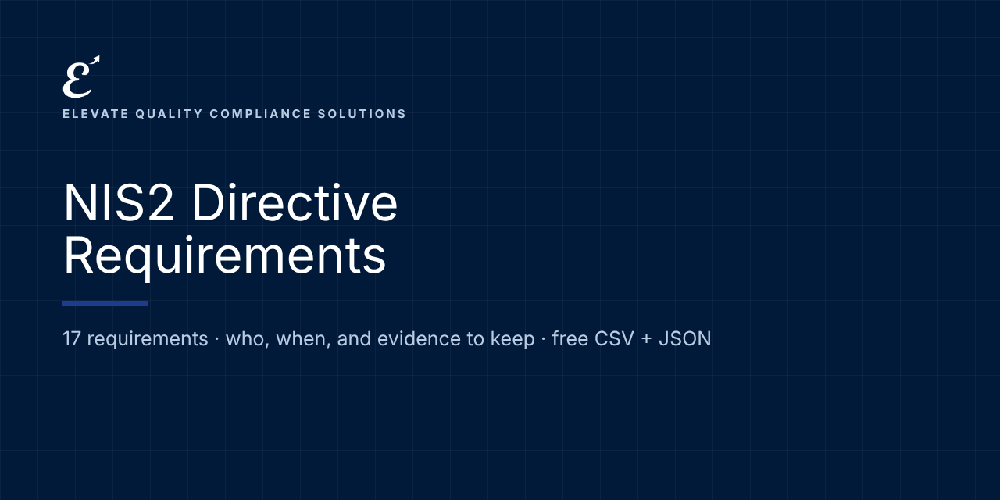

# NIS2 Directive: Requirements and Evidence

   

**Free, machine-readable NIS2 Directive requirements in plain language: who each one applies to, when it applies, and examples of the evidence to keep.** CSV and JSON, ready for Excel, Google Sheets, GRC tools or your own code.

Maintained by [Elevate Quality Compliance Solutions](https://elevateqcs.com). If this saves you time, please ⭐ star the repo so others can find it.

**Source:** Directive (EU) 2022/2555 (NIS2), with our own summaries. National transposition laws add detail; check your country's law.
**Official text:** https://eur-lex.europa.eu/eli/dir/2022/2555/oj

## Key dates
| Date | What applies |
|---|---|
| 2024-10-17 | Member State transposition deadline |
| 2025-04-17 | Member States establish lists of essential and important entities |

## How to use it (2 minutes)
1. **Browse online:** [https://elevate-qcs.github.io/nis2-requirements/](https://elevate-qcs.github.io/nis2-requirements/) and search or filter.
2. **Spreadsheet:** download [`data/requirements.csv`](data/requirements.csv), open it in Excel or Google Sheets, and add columns for status, owner and evidence location. That's your gap assessment.
3. **Code and GRC tools:** load [`data/requirements.json`](data/requirements.json) (format: [`schema/`](schema/requirement.schema.json); examples: [`examples/`](examples/)).

Full guide: [docs/HOW-TO-USE.md](docs/HOW-TO-USE.md) · [FAQ](docs/FAQ.md)

## Requirements (17)
Applies to: essential-entity, important-entity

| Reference | Requirement | Applies to | From | Evidence examples |
|---|---|---|---|---|
| Art. 2-3 | **Scope: essential and important entities**: Check whether you are an essential or important entity based on sector (Annexes I and II), size and national designation. | essential-entity, important-entity | Per national law | Applicability assessment; national registration status. |
| Art. 20 | **Governance and management accountability**: Management bodies approve cybersecurity risk-management measures, oversee them, can be held liable, and must follow training. | essential-entity, important-entity | Per national law | Board approvals; management training records. |
| Art. 21(1) | **Risk-management measures**: Take appropriate and proportionate technical, operational and organizational measures, using an all-hazards approach. | essential-entity, important-entity | Per national law | Risk assessment; security program. |
| Art. 21(2)(a) | **Risk analysis and information system security policies**: Policies on risk analysis and information system security. | essential-entity, important-entity | Per national law | Approved policies. |
| Art. 21(2)(b) | **Incident handling**: Processes to prevent, detect and respond to incidents. | essential-entity, important-entity | Per national law | Incident procedure; incident records. |
| Art. 21(2)(c) | **Business continuity and crisis management**: Backup management, disaster recovery and crisis management. | essential-entity, important-entity | Per national law | Continuity plans; restore tests. |
| Art. 21(2)(d) | **Supply chain security**: Security of relationships with direct suppliers and service providers. | essential-entity, important-entity | Per national law | Supplier assessments; contract clauses. |
| Art. 21(2)(e) | **Secure acquisition, development and maintenance**: Security in network and information systems acquisition, development and maintenance, including vulnerability handling and disclosure. | essential-entity, important-entity | Per national law | Secure development practices; vulnerability management. |
| Art. 21(2)(f) | **Effectiveness assessment**: Policies and procedures to assess the effectiveness of risk-management measures. | essential-entity, important-entity | Per national law | Metrics; internal audits. |
| Art. 21(2)(g) | **Cyber hygiene and training**: Basic cyber hygiene practices and cybersecurity training. | essential-entity, important-entity | Per national law | Training records; hygiene standards. |
| Art. 21(2)(h) | **Cryptography**: Policies on cryptography and, where appropriate, encryption. | essential-entity, important-entity | Per national law | Cryptography policy; key management. |
| Art. 21(2)(i) | **HR security, access control and asset management**: Human resources security, access control policies and asset management. | essential-entity, important-entity | Per national law | Access reviews; asset inventory. |
| Art. 21(2)(j) | **Multi-factor authentication and secure communications**: Use MFA or continuous authentication and secured voice, video, text and emergency communications where appropriate. | essential-entity, important-entity | Per national law | MFA configuration; secure communication tools. |
| Art. 23 | **Incident reporting**: Report significant incidents to the CSIRT or authority: early warning within 24 hours, notification within 72 hours, final report within one month. | essential-entity, important-entity | Per national law | Report timestamps; incident register. |
| Art. 23(1) | **Informing service recipients**: Inform recipients of significant incidents likely to affect their services without undue delay, where appropriate. | essential-entity, important-entity | Per national law | Customer notifications. |
| Art. 3(4), 27 | **Registration with the authority**: Provide required information to the competent authority (for some digital entities, to the registry in the main establishment country). | essential-entity, important-entity | Per national law | Registration confirmation. |
| Art. 32-33 | **Supervision**: Cooperate with supervision: inspections, audits, information requests. | essential-entity, important-entity | Per national law | Request log; audit reports. |

## Implementation kit (launching soon)
This repository tells you **what** is required. Our NIS2 implementation kit gives you **ready-to-adapt documents** to do it: policies, procedures, forms, workbooks, a Kit Navigator and training, mapped to these requirements.
**[Join the launch list](https://elevateqcs.com/coming-soon)** to be notified.

## Disclaimer
This repository is general information to help you understand and organize work on AI governance frameworks. It is not legal advice and does not guarantee compliance, certification or any regulatory outcome. Requirements are summarized in our own words; always check the official texts and get qualified advice for your situation.

## Corrections and contributions
Spotted an error or a change? [Open a correction](../../issues/new?template=correction.md) with a link to the official source. See [CONTRIBUTING.md](CONTRIBUTING.md).

## Reuse and citation
Free under [CC BY 4.0](LICENSE), including commercially, with credit: *"NIS2 Directive Requirements by Elevate Quality Compliance Solutions (elevateqcs.com)"*. See [CITATION.cff](CITATION.cff).

## More open requirements from ElevateQCS
[ISO 9001:2026](https://github.com/elevate-qcs/iso-9001-2026-requirements) · [ISO 14001:2026](https://github.com/elevate-qcs/iso-14001-2026-requirements) · [ISO/IEC 27001:2022](https://github.com/elevate-qcs/iso-27001-2022-requirements) · [DORA (Financial Entities)](https://github.com/elevate-qcs/dora-financial-entities-requirements) · [DORA (ICT Providers)](https://github.com/elevate-qcs/dora-ict-providers-requirements) · [EU AI Act](https://github.com/elevate-qcs/eu-ai-act-requirements) · [ISO/IEC 42001](https://github.com/elevate-qcs/iso-42001-requirements) · [NIST AI RMF](https://github.com/elevate-qcs/nist-ai-rmf-requirements) · [GDPR for AI](https://github.com/elevate-qcs/gdpr-ai-requirements)
